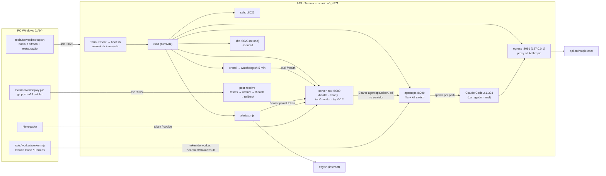

# Arquitetura do servidor A13

Mapa do sistema **como ele está**, medido no aparelho em 2026-10-19 entre 00:28 e 00:55 (hora local, WEST).
O que ainda não foi para produção está marcado **(branch)**. Detalhes que já têm documento próprio ficam nele:
[OPERATIONS](OPERATIONS.md) (comandos), [SECURITY_MODEL](SECURITY_MODEL.md) (segredos e superfícies),
[AGENT_RUNTIME_MATRIX](AGENT_RUNTIME_MATRIX.md) (Claude Code e Hermes), [NETWORK_DNS_FILES](NETWORK_DNS_FILES.md) (SFTP, DNS, acesso remoto).

## 1. O aparelho (fatos medidos)
| Item | Valor | Como foi medido |
|---|---|---|
| Modelo | Samsung SM-A135M, Android 14 | `getprop` |
| CPU | Exynos 850, 8 núcleos; kernel 64 bits, **userspace 32 bits** (`armv8l`) | `uname -m`, `/proc/cpuinfo` |
| RAM física | 3,62 GiB (`MemTotal` 3.886.809.088 B) | `/proc/meminfo` |
| Swap | 4 GiB: é o "RAM Plus" do Android, **não é RAM** | `/proc/meminfo SwapTotal` |
| Disco | 109 GB, 102 GB livres | `df -k /data` |
| Node | v24.18.0 (`nodejs-lts`) | `node --version` |
| Bateria | 82%, sem carregar (proteção em 80%), 27–31 °C | `termux-battery-status` |

**Limites do Android sem root** (todos testados, por isso o painel mostra "indisponível" e não inventa número):
`/proc/stat`, `/proc/loadavg`, `/proc/pressure/*` e `/sys/class/thermal` → *Permission denied* (SELinux);
`os.cpus()` devolve 0 núcleos; o Termux só enxerga os **próprios** processos (37 de 561); portas < 1024 são proibidas.
**A carga média engana:** 11,4 com 762% de 800% ociosos no `adb shell top`. No Android ela conta threads do kernel,
então não serve como % de CPU nem como gatilho de alerta.

## 2. Componentes


| Componente | Código | Processo / porta | Supervisor | Log |
|---|---|---|---|---|
| Boot | `server/termux/boot.sh` | Termux:Boot, uma vez | — | `~/servidor/logs/boot.log` |
| Supervisor | termux-services (runit) | `runsvdir $PREFIX/var/service` | boot.sh | — |
| SSH | OpenSSH 10.6, `sshd-servidor.conf` | :8022 | runit | `$PREFIX/var/log/sv/sshd/current` |
| Agendador | cronie | `crond` | runit | `$PREFIX/var/log/sv/crond/current` |
| Watchdog | `server/termux/watchdog.sh` | cron `*/5` | crond | `~/servidor/logs/watchdog.log` |
| Painel | `server/panel/server-box` (git, branch `celular`) | `node server.js` :8080 | runit | `~/servidor/logs/server-box/current` |
| Alertas | `server-box/alerts.mjs` | `node alerts.mjs` | runit | `~/servidor/logs/alertas/current` |
| AgentOps | `server/agentops` | `node server.mjs` :8090 | runit | `~/servidor/logs/agentops/current` + `agentops-data/events.jsonl` |
| Proxy de saída | `server/termux/egress-proxy.mjs` | 127.0.0.1:8091 | runit | `~/servidor/logs/egress/current` |
| Arquivos | rclone `serve sftp` | :8023 | runit | `~/servidor/logs/sftp/current` |
| Deploy | `server/termux/git-hooks/post-receive` | no `git push` | — | `~/servidor/logs/deploy.log` |
| Worker remoto | `tools/worker/worker.mjs` | no PC, quando ligado | manual | console do PC |

## 3. Camadas e contratos
| Camada | Onde | Contrato |
|---|---|---|
| 1. Host (adaptador Android) | `host-runit.mjs`, `host-metrics.mjs`, `monitor.js` **(branch para os dois primeiros)** | Só leitura de arquivos e comandos fixos (`ps`, `du`, `df`, `uptime`, `getprop`, `termux-battery-status`). Nada recebe texto do usuário. Cada métrica sai com `value`, `unit`, `source` e `at`. |
| 2. API do painel | `server.js`, `console-api.mjs` **(branch)** | `/health` (vivo, público) · `/ready` (prontidão, público, só `{ok}`) · `/api/monitor` (contrato antigo, intacto) · `/api/v1/*` (token). Erro: `{ok:false, code, error, requestId}`. Todo pedido recebe `X-Request-Id`. |
| 3. Orquestração | `server/agentops` | Tarefa = perfil + texto, nunca comando. Estados `queued → running → succeeded / failed / cancelled`. Lease com `leaseId` para workers, tentativas com teto, backoff com jitter, kill switch persistido, perfil `idempotent:false` nunca repete sozinho. Fila em `state.json` (escrita atômica + fsync). |
| 4. Observabilidade | `alerts.mjs`, svlogd, `/api/v1/logs`, `/api/v1/history` **(branch)** | Os alertas rodam em processo separado do painel (avisam quando o painel cai). Os logs giram pelo svlogd. O histórico fica em memória (24 h, zera ao reiniciar o painel). |
| 5. Interface | `public/status.html` (em produção), `public/console.*` (outra sessão, branch `claude/painel-v2-front`) | Só apresenta. Autorização, validação e execução ficam no backend. |
| 6. Externos | ntfy.sh, Anthropic (via egress), worker do PC | Se algum cair, só o recurso dele fica indisponível: o painel continua respondendo (testado com o AgentOps fora: `/api/v1/overview` 200 com `agents.available:false`). |

Rotas e formatos da `/api/v1`: ver os testes `test/console.test.mjs` e `test/host-metrics.test.mjs` e os exemplos reais em `test/fixtures/` (branch `claude/painel-v2`).

## 4. Fronteiras de confiança
```
Internet ──(roteador: sem redirecionamento de porta IPv4; filtro de IPv6 de entrada NÃO VERIFICADO)──► LAN de casa
LAN ──► A13 :8022 (só chave) · :8080 (token) · :8090 (tokens admin/worker) · :8023 (chave própria)
A13, usuário u0_a271 ──► TODOS os serviços e agentes rodam com o MESMO usuário Linux
Android (SELinux) ──► bloqueia /proc, /sys/class/thermal e portas < 1024 para o Termux
```
- **Mesmo usuário para tudo:** sem root não existe outro usuário, namespace nem chroot. Os tokens em `~/servidor` (permissão 600) ficam legíveis por qualquer processo do Termux. O que separa o Claude Code local desses arquivos são as regras de negação do próprio Claude Code (isolamento lógico). Com o login feito, a outra sessão registrou no LOG que a leitura do arquivo de tokens dos workers foi negada; por isso o adaptador roda com `--permission-mode dontAsk`. Ver [SECURITY_MODEL](SECURITY_MODEL.md).
- **IPv6 global (achado de 19/10, 00:55; corrigido às 00:58):** o A13 tem endereço IPv6 global estável (`2a0d:…:142c:79ff:feb4:cc79`). Do PC, por esse endereço, respondiam o **sshd :8022**, o **SFTP :8023** e o **painel :8080**. Corrigido: sshd com `AddressFamily inet` + `ListenAddress 0.0.0.0:8022`, SFTP preso ao IPv4 do wlan0 (no Go, `0.0.0.0` também abre IPv6) e painel em `0.0.0.0` (produção `b710d61`). **Conferido de novo do PC:** 8022, 8023 e 8080 recusam pelo IPv6 e o painel em IPv4 responde 200. Regra: serviço novo sempre com endereço IPv4 explícito. Ainda não sabemos se o roteador filtrava IPv6 de entrada (T13).
- **Painel (branch):** ações só por `POST` de uma lista fixa, com token, cabeçalho `X-Painel-Acao: 1`, mesma origem, limite de 30 por minuto e auditoria em `~/servidor/logs/painel-audit.jsonl`. Login errado também vai para a auditoria. Logs só de uma lista fixa de fontes, lidos pelo fim do arquivo (256 KB / 500 linhas), com segredos escondidos e recusa de link simbólico para fora. `/console` com CSP estrita (sem script inline).

## 5. Ciclo de vida
| Evento | O que acontece | Medido |
|---|---|---|
| Boot do aparelho | Termux:Boot → `boot.sh` → wake-lock → runsvdir → serviços | servidor completo em **73 s** (reboot de 19/10, 00:08) |
| Processo cai | runit religa | ~1 s (painel com `kill -9`) |
| Painel responde mas trava | watchdog (cron 5 min) chama `/health` e reinicia | até 5 min |
| Deploy | `git push a13 celular` → testes → restart → `/health` em 15 s → senão `git reset` + restart | push quebrado voltou sozinho em 7 s |
| Painel fora | `alertas` acusa depois de 2 falhas seguidas → ntfy | CRÍTICO em +100 s, Recuperado em +60 s |
| AgentOps reinicia | tarefa local em andamento volta para a fila (ou vai para `failed` se o perfil não é idempotente); tarefa remota com lease válido continua com o worker | testes do agentops (15/15 no A13) |
| Worker do PC some | lease vence → tarefa volta para a fila com backoff; agente aparece `degraded` | testes do agentops |
| Sem internet | nada é avisado (ntfy depende dela) | **risco aberto** |
| Disco cheio | AgentOps responde 500 (antes era 400); svlogd para de escrever | simulado só no PC |

## 6. Dependências
```
boot.sh ─► runit ─► { sshd, crond, server-box, alertas, agentops, egress, sftp }
crond ─► watchdog.sh ─► /health do painel
alertas ─► /api/monitor (painel.token) ─► ntfy.sh
server-box /api/v1 ─► runit supervise/status (leitura) · AgentOps :8090 (opcional) · ps/du/df · ntfy.sh (teste de rede)
agentops ─► Claude Code (~/opt/claude-code) ─► egress :8091 ─► Anthropic
worker do PC ─► agentops :8090 (token de worker)
deploy ─► sshd :8022 ─► post-receive ─► testes do painel ─► runit
backup.sh (PC) ─► sshd :8022
```
Fonte única de cada estado: serviços = runit (`supervise/status`); tarefas = `agentops-data/state.json`; métricas = leitura na hora (o histórico em memória é só cópia); deploy = `deploy.log` + git do A13.

## 7. Riscos abertos (em ordem)
1. Serviço novo que escute sem endereço explícito volta a aparecer no IPv6 global (o roteador não foi verificado). Conferir com o teste da §4.
2. Todos os serviços e agentes usam o mesmo usuário Linux: as regras do Claude Code são a única barreira até os tokens.
3. Sem internet, nenhum alerta sai.
4. Backup só no PC, que fica na mesma casa: falta um destino externo.
5. Toque fantasma na tela quebrada: pode clicar em coisas, principalmente com o Chrome ligado (o Gemini ligou para o login do Tailscale).
